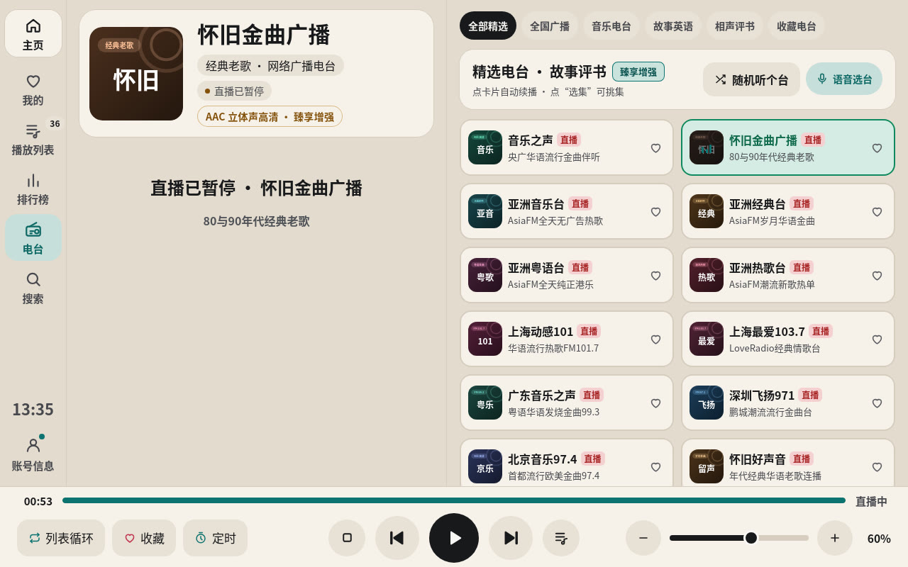
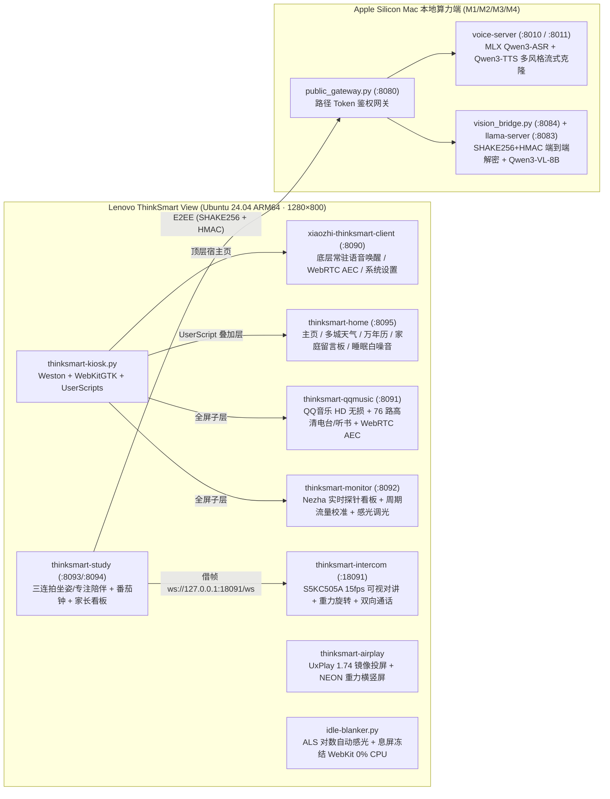

# ThinkSmart View (CD-18781Y) 桌面智能中枢全栈套件

将联想 **ThinkSmart View (`CD-18781Y`, Qualcomm APQ8053 / 8" 1280×800 IPS 触控屏 / TAS5782M Hi-Fi 功放 / 双数字麦克风 / S5KC505A 摄像头)** 改造为一台运行在 **Ubuntu 24.04 + Wayland (Weston) + PipeWire** 上的全功能家庭桌面智能中枢，并配套 **Apple Silicon (MLX / llama.cpp)** 本地语音克隆与端到端加密视觉大模型算力后端。

> **零侵入解耦设计**：所有自研服务均独立运行于 `/usr/local/{bin,share,lib}` 与 `/opt/thinksmart-addons/`，对第三方小智语音客户端采用 `sitecustomize.py` Git-Blob 哈希校验热挂载（上游在线升级时自动安全回退，绝不阻塞启动或丢失定制功能）。

---

## 实机成品界面参考（1280×800 触控屏）

### 1. 桌面智能主页（天气 / 日出日落 / 农历月历·倒数日 / 无损音乐·电台 / 家庭留言板）


### 2. 无损音乐与高清网络电台（音乐电台 / 全国广播 / 少儿故事英语 / 相声评书 · 母带调音与断点续播）


### 3. 番茄专注计时与自然双层声景（联动摄像头坐姿/专注陪伴）


### 4. 服务器实时探针看板（多节点负载 / 三网延迟 / 持久化月流量周期账本）


---

## 系统架构总览



---

## 核心功能模块

### 1. 设备端套件 (`device/`)

| 目录 | 服务 / 组件 | 核心特性 |
| --- | --- | --- |
| [`device/home/`](device/home/) | `thinksmart-home.py` (`:8095`) | **1280×800 桌面主页**：和风天气全屏详情页（支持多城市秒切、24 小时曲线、7 日温差条、国标 6 项空气质量污染物与生活指数）、农历节气万年历、**三端倒数日/公农历生日（含闰月与周岁换算）/纪念日/正数日（桌面 + 小智语音 + 手机端联动）**、**家庭双向语音/文字留言板与定时提醒**、**助眠白噪音双层混音 + 晨间日出渐亮温柔叫醒**、番茄专注计时；深色 / 暖米浅色双主题随日出日落自动切换。 |
| [`device/qqmusic/`](device/qqmusic/) | `thinksmart-qqmusic.py` (`:8091`) | **独立无损音乐与高清网络电台服务**：支持扫码登录同步绿钻 VIP 与「我喜欢」歌单、SQ 无损 FLAC 经 `ffmpeg + SoXR (precision=28)` 直出 `48kHz F32LE`、逐行同步滚动歌词、巅峰榜与触屏拼音软键盘；内置 **76 路精选电台与有声频道**（28 路 HTTPS AAC/HE-AAC 高音质音乐电台 + 22 路全国与省市广播 + 16 路少儿故事英语名著 + 10 路相声评书），配备机身扬声器定制三档母带音效（`臻享增强 / 清澈人声 / 原声直通`）、听书自动断点续播记忆、「继续收听」快捷条与正倒序选集抽屉；通过 `aec_bridge_sitecustomize.py` 无侵入桥接 WebRTC `aec.feed_far` 硬件回声消除与语音点歌/选台/控播工具，放歌听台时仍可随时语音唤醒打断。 |
| [`device/monitor/`](device/monitor/) | `thinksmart-monitor.py` (`:8092`) | **服务器实时状态看板与顶栏叠加层**：按需连接 Nezha WebSocket（页面关闭 90 秒后自动断开省流量）、月度账期双向流量校准、单机延迟曲线；`home_overlay.js` 以 `iframe` 叠加层将主页 (`:8095`)、音乐 (`:8091`)、监控 (`:8092`) 常驻覆盖在 `:8090` 上（在子页面/设置页唤醒时会弹出顶部语音胶囊条 `#tsVoicePill`，点按可随时展开小智），并提供空闲 60 秒自动暂停 CSS 动画大幅降低功耗。 |
| [`device/intercom/`](device/intercom/) | `thinksmart-intercom.py` (`:18091`) | **远程双向可视对讲**：点亮机身 S5KC505A 摄像头，联动物理镜头盖 (`gpio87`) 与麦克风静音键 (`gpio86`)，读取 `BMA253` 重力传感器自动扶正 `0°/90°/180°/270°` 画面，支持手机网页省流模式、现场监听、全双工视频通话、家庭留言板远程收发及**手机端倒数日/公农历生日在线管理**。 |
| [`device/study/`](device/study/) | `thinksmart-study.py` (`:8093` / `:8094`) | **AI 学习坐姿与专注陪伴**：手动开启（带 3 小时自动关闭安全锁），每分钟 3 张跨 8 秒连拍过滤瞬间动作，经 **SHAKE256 + HMAC-SHA256 端到端加密**送交本地视觉模型判断坐姿/趴桌/走神/玩手机，连续命中后用自然克隆童声/女声温和提醒（自动避让通话/投屏并暂停恢复背景音乐）；内置响应式手机/电脑家长统计页（只存脱敏文字结果，零照片落盘）。 |
| [`device/system/`](device/system/) | `idle-blanker.py` / `thinksmart-airplay.py` 等 | **底层电源、显示、投屏与外设守护**：环境光对数曲线平滑调光（夜间最低可至 `0%`）、息屏 `SIGSTOP` 冻结 `WebKitWebProcess` 实现息屏应用 `0%` CPU、Adreno GPU 恢复看门狗、AirPlay 镜像时期 CPU/GPU 绑核提权与 Wayland 自动重连、底部 Type-C 接口 USB Host 热插拔自动挂载。 |
| [`device/prebuilt/arm64/`](device/prebuilt/arm64/) | `s5kc505a_cam_helper` / `uxplay` / `.dtb` 等 | **ARM64 硬件增强预编译包（附 SHA256 校验与 DTS 补丁源码）**：包含 `S5KC505A` 15fps 零常驻功耗软 ISP 采集器与摄像头设备树、定制版 `UxPlay 1.74`（修复新版 iOS 花屏 + `WMM AC_VI` 无线加速 + `48kHz F32LE` 音频）、`BMA253` ARM64 NEON 重力自动旋转插件及 PipeWire `FDK-AAC` 高清蓝牙编码插件。 |
| [`device/xiaozhi-overrides/`](device/xiaozhi-overrides/) | `sitecustomize.py` + `files/` | **小智 Hub 无侵入热补丁加载器**：启动时逐文件校验官方 Git Blob SHA，匹配时才挂载 `64kbps` 全频带 Opus 高音质编码、流式 TTS 增强、QQ 音乐语音桥接与管理后台鉴权/SSRF 加固（共 21 个模块），上游更新后自动回退官方模块，保证零启动故障。 |
| [`device/configs/`](device/configs/) | `systemd` / `pam.d` / `pipewire` / `wireplumber` / `bluetooth` | **全链路 Hi-Fi 音频与系统加固配置**：PipeWire `48kHz` 原生时钟 + `resample.quality=10` (256-tap sinc) + `wannamaker3` 心理声学抖动、蓝牙音箱免 PIN 高清配对、高通 `q6asm` 防死锁 ALSA 保护、QCA9379 Wi-Fi 省电关闭及 `NetworkManager-wait-online` 秒级放行。 |
| [`device/tests/`](device/tests/) | `test_*.py` | **自动化回归测试集**：覆盖主页、三端倒数日与公农历/闰月换算、多城天气详情、留言板与定时提醒、睡眠唤醒、QQ音乐收藏与网络电台/听书续播、服务器看板与安全边界校验。 |

### 2. Apple Silicon 本地算力配套端 (`mac-companion/`)

| 目录 | 组件 | 核心特性 |
| --- | --- | --- |
| [`mac-companion/voice-server/`](mac-companion/voice-server/) | `server.py` + `tts_speedups.py` + `public_gateway.py` | **MLX 本地语音识别与多风格流式克隆服务 (`:8010` / `:8011`)**：基于 `Qwen3-ASR-1.7B` 与 `Qwen3-TTS-12Hz-1.7B-Base`；`tts_speedups.py` 通过 `mx.compile` 编译 15 步声码预测图并缓存解码器参考尾帧状态，在 M1 Pro 上实现 **`~300ms` 首包延迟、`RTF ~0.6x`**；内置 `calm / flow / warm / question` 四风格防单调轮换、`200ms` 参考静音隔离带、显式语种注入及动态音节软硬双层防失控保护；支持主从双进程并发溢出 (`TTS_OVERFLOW_URL`)、**副 TTS 进程空闲自动休眠卸载 (`TTS_IDLE_SLEEP_SECONDS`) 与请求到来秒级自唤醒**，以及 ASR 上传 (`25 MiB`) 与网关请求体 (`16 MiB`) 安全上限。 |
| [`mac-companion/study-vision/`](mac-companion/study-vision/) | `vision_bridge.py` + `llama-server` | **学习陪伴端到端加密视觉桥接 (`:8084` -> `:8083`)**：纯标准库实现 `SHAKE256 + HMAC-SHA256` 双向加解密与 `120s` 防重放窗口，按设备重力角调用系统 `sips` 自动转正画面（内存/0700 临时目录即用即焚），内置 `10 MB` 定时拷贝截断日志轮转，串行调度本地 `llama-server` (`Qwen3-VL-8B-Instruct`，支持 10 分钟空闲自动休眠释放显存)。 |

---

## 目录结构

```text
thinksmart-view/
├── docs/
│   └── images/               # 1280×800 实机成品界面预览图
├── device/
│   ├── install.sh            # 设备端一键二次安装、依赖补齐与安全升级脚本
│   ├── diagnose-wake.sh      # 整机服务、硬件组件与跨界面语音唤醒只读自检脚本
│   ├── prebuilt/arm64/       # 预编译摄像头 ISP、设备树补丁、UxPlay 1.74、NEON 旋转与蓝牙 AAC 插件
│   ├── home/                 # 桌面主页、多城天气详情、万年历、家庭留言板、助眠与专注计时
│   ├── qqmusic/              # 独立 QQ 音乐 HD 无损、76 路网络电台/听书与 WebRTC AEC 桥接钩子
│   ├── monitor/              # Nezha 服务器看板、流量校准、显示控制与顶栏叠加层
│   ├── intercom/             # 远程双向可视对讲、全屏通话 UI 与反向 SSH 隧道脚本模板
│   ├── study/                # AI 学习陪伴服务与家长手机/电脑端统计面板
│   ├── kiosk/                # 首次联网 Wi-Fi 向导、虚拟软键盘等 Kiosk 静态资源
│   ├── system/               # 自动感光息屏守护、AirPlay 调度器、Kiosk 启动器与 DMIC 音频桥
│   ├── xiaozhi-overrides/    # 小智 Hub Git-Blob 校验无侵入加载器与高音质补丁
│   ├── configs/              # systemd / PAM / PipeWire / WirePlumber / Bluetooth / udev / sysctl
│   └── tests/                # 设备端自动化单元与接口回归测试套件
└── mac-companion/
    ├── install-mac.sh        # Mac 算力端一键环境初始化与 LaunchAgent 生成脚本
    ├── voice-server/         # Apple Silicon MLX 本地 ASR + Qwen3-TTS 流式语音克隆与网关
    └── study-vision/         # 学习陪伴 E2EE 视觉桥接服务与 Qwen3-VL LaunchAgent 模板
```

---

## 快速部署指引

### 前置必读：刷机顺序与小智底座依赖关系

> **安装后配什么 Key、选什么大模型？** 请直接参阅配套手册 👉 **[《安装后用户自备配置清单与大模型选型指南（含本地 vs 云端方案）》](docs/USER_GUIDE.md)**。

**是的，本套系统属于基于「小智语音底座」的二次安装全栈扩展套件**，完整安装只需两步，**不需要**在裸 Ubuntu 上自己从零手动编译安装小智：

1. **第一步（刷入已内置小智的社区 Ubuntu 24.04 底包）**：
   - 按照 [`justhalfbit/thinksmart-ubuntu-image`](https://github.com/justhalfbit/thinksmart-ubuntu-image) 官方刷机指南，将社区固件镜像刷入联想 `ThinkSmart View (CD-18781Y)`。
   - **该底包出厂已预装好** Ubuntu 24.04 ARM64、声卡/触控/光线传感器驱动、Weston 显示服务，以及完整的小智客户端 [`xiaozhi-thinksmart-client`](https://github.com/justhalfbit/xiaozhi-thinksmart-client)（`thinksmart-client.service` `:8090`）与本地服务端 `xiaozhi-hub-server`（`:16688`）。
   - *注意：切勿刷不含小智的上游裸机镜像，因为本套件依赖小智 `:8090` 作为最底层常驻宿主（负责 `sherpa-onnx` 离线唤醒词监听、WebRTC 硬件回声消除、语音对话以及系统 Wi-Fi / 设置抽屉面板）。*
2. **第二步（运行本仓库一键二次安装脚本）**：
   - 底包开机连上 Wi-Fi 后，SSH 登录设备克隆本仓库，执行 `sudo bash device/install.sh`，首次安装完执行一次 `sudo reboot` 激活前置摄像头设备树即可投入使用。
   - 所有自研服务均隔离安装在 `/opt/thinksmart-addons/venv` 中，后续小智客户端或 Hub 在线升级时**互不干扰、不会被覆盖**。

---

### 一、设备端一键安装（Lenovo ThinkSmart View · Ubuntu 24.04 ARM64）

```bash
git clone https://github.com/fubin0478/thinksmart-view.git
cd thinksmart-view
sudo bash device/install.sh
```

`device/install.sh` 会自动完成以下全部工作（支持重复运行无损升级）：
- 预检 `aarch64` 架构与 `thinksmart-client.service` 小智底座；
- 自动检测并按需通过 `apt` 补齐底包缺失的运行库（`python3-dbus`、`python3-gi`、`python3-smbus2`、`ffmpeg`、`avahi-daemon`、`gstreamer1.0-gl`、`gstreamer1.0-plugins-bad`、`libfdk-aac2`、`exfatprogs`、`ntfs-3g` 等）；
- 创建独立 `/opt/thinksmart-addons/venv` 环境并安装 `aiohttp`、`numpy`、`lunar_python`；
- 校验 SHA256 后部署 `S5KC505A` 摄像头软 ISP 采集器、摄像头设备树补丁（自动备份 `/boot/apq8053-lenovo-cd-18781y.dtb.bak`，仅对匹配的 `20261101` 原厂底包安全替换）、`UxPlay 1.74`、`NEON` 重力旋转库及蓝牙 `AAC` 编码器；
- 部署 WebRTC AEC 回声消除桥接钩子（`/usr/local/lib/thinksmart-aec-bridge/sitecustomize.py`）、小智 Hub 无侵入热补丁、PAM/音频/蓝牙/U盘自动挂载配置，屏蔽冲突的 `shairport-sync` / `iio-sensor-proxy` / `udisks2` 服务，并确保 `/etc/thinksmart-kiosk.conf` 顶层 URL 指向 `http://127.0.0.1:8090/`。

**首次安装后执行一次重启与自检**：
```bash
sudo reboot
# 重启后可随时运行只读自检脚本，确认全部服务、摄像头与跨界面唤醒链路 PASS：
bash device/diagnose-wake.sh
```

#### 个性化配置（推荐使用 systemd drop-in，升级不丢失）

为避免后续 `git pull && sudo bash device/install.sh` 覆盖您的私有参数，建议通过 `local.conf` 配置环境变量：
- **天气城市与和风 API Key**：新建 `/etc/systemd/system/thinksmart-home.service.d/local.conf`（完整申请与大模型选型见 [`docs/USER_GUIDE.md`](docs/USER_GUIDE.md)）：
  ```ini
  [Service]
  Environment=QWEATHER_API_HOST=您的专属域名.re.qweatherapi.com
  Environment=QWEATHER_API_KEY=您的和风天气API_KEY
  Environment=WEATHER_DEFAULT_CITY=北京 WEATHER_EXTRA_CITIES=上海,广州,深圳
  ```
- **Nezha 服务器探针看板**：新建 `/etc/systemd/system/thinksmart-monitor.service.d/local.conf` 设置 `Environment=NEZHA_HOST=your-nezha.example.com`，并参考 [`servers.example.json`](device/monitor/servers.example.json) 与 [`traffic.example.json`](device/monitor/traffic.example.json) 编辑 `/usr/local/share/thinksmart-monitor/{servers,traffic}.json`（`install.sh` 不会覆盖已存在的 `servers.json` / `traffic.json`）。
- **自定义高品质助眠环境音（可选）**：系统内置离线 FFT 无缝声景合成兜底（开箱即用）；如需更高音质的真实自然录音循环，可将同名 `.flac` / `.m4a`（如 `rain.flac`、`waves.flac`）放入 `/home/ubuntu/.config/thinksmart-qqmusic/ambient/`。

---

### 常见问题：为什么切到主页/其他界面无法唤醒小智？

可先在设备上运行只读排查脚本 **`bash device/diagnose-wake.sh`**，重点检查以下四项：
1. **顶层 URL 被改成了 `:8095`**：如果把 `/etc/thinksmart-kiosk.conf` 的 `URL` 改成了 `http://127.0.0.1:8095/`，顶层会直接退出 `home_overlay.js`，唤醒后画面切不回小智。修复：`sudo kiosk-mode url http://127.0.0.1:8090/ && sudo kiosk-mode restart`。
2. **底包未安装后台语音客户端**：若系统运行的不是后台常驻麦克风监听的 `xiaozhi-thinksmart-client`（`thinksmart-client.service`），而是依赖浏览器标签页录音的网页客户端，页面一旦跳转就会失去麦克风。
3. **漏部署或未重命名 `sitecustomize.py`**：手动复制时若未把 `aec_bridge_sitecustomize.py` 重命名为 `/usr/local/lib/thinksmart-aec-bridge/sitecustomize.py`，播放音乐/电台/助眠声景会绕过 WebRTC 回声消除直接外放，声音会盖过人声唤醒词。
4. **未更新 `/usr/local/bin/thinksmart-kiosk.py` 或用户态配置放错账号目录**：旧版 `thinksmart-kiosk.py` 不会加载 `home_overlay.js`；而 `pipewire / wireplumber / systemd/user` 必须位于 `/home/ubuntu/.config/` 下（`install.sh` 已固定锁定 `ubuntu` 账号，兼容 `root` 或其他管理员 `sudo` 执行）。

---

### 二、Mac 算力端部署（Apple Silicon，可选扩展）

如果您希望使用本地 Apple Silicon Mac 提供超低延迟克隆音色 TTS、家庭词库增强 ASR 以及学习陪伴加密视觉推理，可直接运行一键初始化脚本：

```bash
bash mac-companion/install-mac.sh
```

该脚本会自动完成：
1. 创建 `mac-companion/voice-server/.venv` 并根据 [`requirements.txt`](mac-companion/voice-server/requirements.txt) 安装 `fastapi`、`uvicorn`、`python-multipart`、`httpx`、`mlx`、`mlx-audio`、`num2words` 等全部依赖；
2. 自动生成 `~/.config/thinksmart-voice/public_gateway.json` 随机网关 Token 与 `~/.config/study-vision/secret` 32 字节共享密钥（`chmod 600`，将生成的 `secret` 复制到设备 `/var/lib/thinksmart-study/secret` 即可配对端到端加密通道）；
3. 自动将 `launchd/*.plist.example` 中的路径替换为当前 Mac 真实用户名与仓库目录，写入 `~/Library/LaunchAgents/`。

随后放入模型并启动：
- **语音识别与克隆 (`voice-server`)**：将 `Qwen3-ASR-1.7B-8bit` 与 `Qwen3-TTS-12Hz-1.7B-Base-8bit` 放入 `mac-companion/voice-server/models/`，参考 [`voices.example.json`](mac-companion/voice-server/voices/voices.example.json) 配置参考音频。
- **学习陪伴视觉模型 (`study-vision`)**：执行 `brew install llama.cpp`，将 `Qwen3VL-8B-Instruct-Q4_K_M.gguf` 与 `mmproj-Qwen3VL-8B-Instruct-Q8_0.gguf` 放入 `mac-companion/study-vision/models/`。
- **统一启停与健康检查**：
  ```bash
  bash mac-companion/voice-server/manage.sh start all
  bash mac-companion/voice-server/manage.sh status
  ```

---

## 隐私与安全说明

- **零明文凭据入库**：所有 API Key（和风天气、搜索、大模型）、网关 Token、QQ 音乐登录态、SSH 密钥及学习陪伴共享密钥均在运行时从本地 `0600/0700` 受限目录读取，仓库中不含任何密钥或个人隐私信息。
- **端到端加密与零图像落盘**：学习陪伴采样帧通过 `SHAKE256 + HMAC-SHA256`（含随机 Nonce 与时间戳防重放）端到端密封传输，推理后内存即刻释放，设备与服务端均不留存任何摄像头图像。
- **严格的同源与内网边界**：本机写接口均实施 `Host` / `Origin` / 专用请求头校验及 SSRF 私网地址过滤，防止跨站请求伪造与越权调用。

---

## License

[MIT License](LICENSE)（`device/prebuilt/arm64/` 下各独立预编译硬件组件遵循其对应开源许可，详见 [`device/prebuilt/arm64/README.md`](device/prebuilt/arm64/README.md)）。
