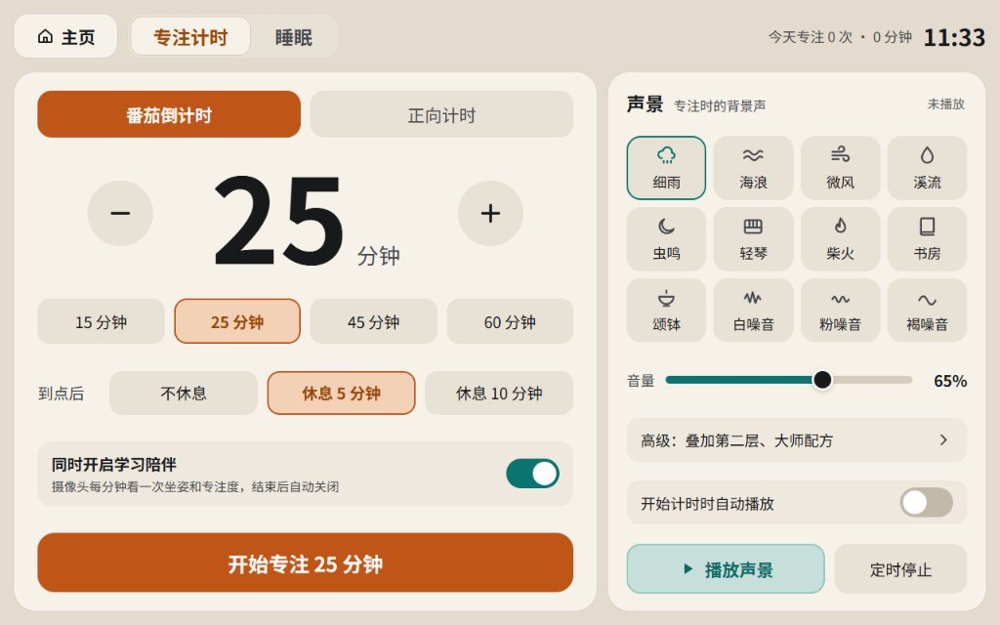
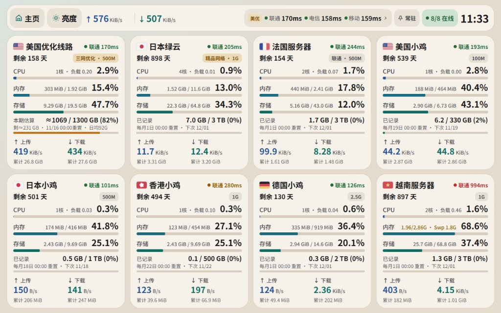
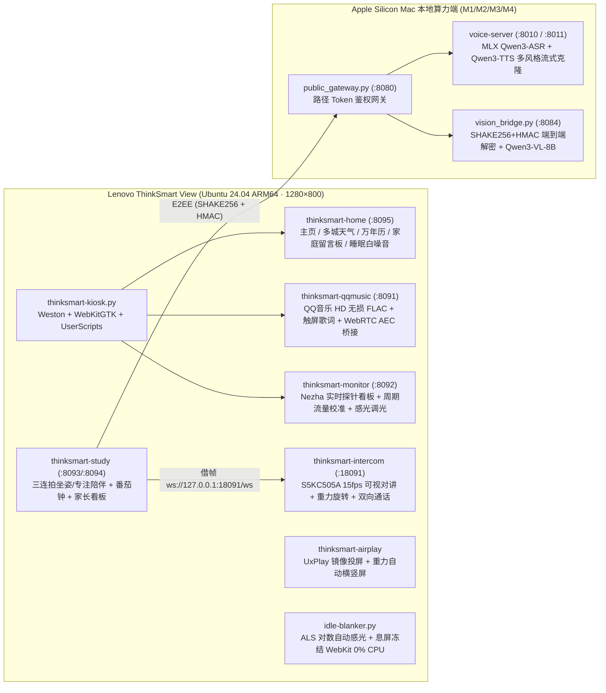

# ThinkSmart View (CD-18781Y) 桌面智能中枢全栈套件

将联想 **ThinkSmart View (`CD-18781Y`, Qualcomm APQ8053 / 8" 1280×800 IPS 触控屏 / TAS5782M Hi-Fi 功放 / 双数字麦克风 / S5KC505A 摄像头)** 改造为一台运行在 **Ubuntu 24.04 + Wayland (Weston) + PipeWire** 上的全功能家庭桌面智能中枢，并配套 **Apple Silicon (MLX / llama.cpp)** 本地语音克隆与端到端加密视觉大模型算力后端。

> **零侵入解耦设计**：所有自研服务均独立运行于 `/usr/local/{bin,share,lib}` 与 `/opt/thinksmart-addons/`，对第三方小智语音客户端采用 `sitecustomize.py` Git-Blob 哈希校验热挂载（上游在线升级时自动安全回退，绝不阻塞启动或丢失定制功能）。

---

## 实机成品界面参考（1280×800 触控屏）

### 1. 桌面智能主页（天气 / 日出日落 / 农历月历 / 无损音乐歌词 / 家庭留言板）


### 2. 番茄专注计时与自然双层声景（联动摄像头坐姿/专注陪伴）


### 3. 服务器实时探针看板（多节点负载 / 三网延迟 / 持久化月流量周期账本）


---

## 系统架构总览



---

## 核心功能模块

### 1. 设备端套件 (`device/`)

| 目录 | 服务 / 组件 | 核心特性 |
| --- | --- | --- |
| [`device/home/`](device/home/) | `thinksmart-home.py` (`:8095`) | **1280×800 桌面主页**：和风天气全屏详情页（支持多城市秒切、24 小时曲线、7 日温差条、国标 6 项空气质量污染物与生活指数）、农历节气万年历、**三端倒数日/公农历生日（含闰月与周岁换算）/纪念日/正数日（桌面 + 小智语音 + 手机端联动）**、**家庭双向语音/文字留言板与定时提醒**、**助眠白噪音双层混音 + 晨间日出渐亮温柔叫醒**、番茄专注计时；深色 / 暖米浅色双主题随日出日落自动切换。 |
| [`device/qqmusic/`](device/qqmusic/) | `thinksmart-qqmusic.py` (`:8091`) | **独立无损音乐服务**：支持扫码登录同步绿钻 VIP 与「我喜欢」歌单、SQ 无损 FLAC 经 `ffmpeg + SoXR (precision=28)` 直出 `48kHz F32LE`、逐行同步滚动歌词、巅峰榜与触屏拼音首字母软键盘；通过 `aec_bridge_sitecustomize.py` 无侵入桥接 WebRTC `aec.feed_far` 硬件回声消除与语音点歌/控播/倒数日工具，放歌时仍可随时语音唤醒打断。 |
| [`device/monitor/`](device/monitor/) | `thinksmart-monitor.py` (`:8092`) | **服务器实时状态看板与顶栏叠加层**：按需连接 Nezha WebSocket（页面关闭 90 秒后自动断开省流量）、月度账期双向流量校准、单机延迟曲线；`home_overlay.js` 以 `iframe` 叠加层将主页 (`:8095`)、音乐 (`:8091`)、监控 (`:8092`) 常驻覆盖在 `:8090` 上（在子页面/设置页唤醒时会弹出顶部语音胶囊条 `#tsVoicePill`，点按可随时展开小智），并提供空闲 60 秒自动暂停 CSS 动画大幅降低功耗。 |
| [`device/intercom/`](device/intercom/) | `thinksmart-intercom.py` (`:18091`) | **远程双向可视对讲**：点亮机身 S5KC505A 摄像头，联动物理镜头盖 (`gpio87`) 与麦克风静音键 (`gpio86`)，读取 `BMA253` 重力传感器自动扶正 `0°/90°/180°/270°` 画面，支持手机网页省流模式、现场监听、全双工视频通话、家庭留言板远程收发及**手机端倒数日/公农历生日在线管理**。 |
| [`device/study/`](device/study/) | `thinksmart-study.py` (`:8093` / `:8094`) | **AI 学习坐姿与专注陪伴**：手动开启（带 3 小时自动关闭安全锁），每分钟 3 张跨 8 秒连拍过滤瞬间动作，经 **SHAKE256 + HMAC-SHA256 端到端加密**送交本地视觉模型判断坐姿/趴桌/走神/玩手机，连续命中后用自然克隆童声/女声温和提醒（自动避让通话/投屏并暂停恢复背景音乐）；内置响应式手机/电脑家长统计页（只存脱敏文字结果，零照片落盘）。 |
| [`device/system/`](device/system/) | `idle-blanker.py` / `thinksmart-airplay.py` 等 | **底层电源、显示、投屏与外设守护**：环境光对数曲线平滑调光（夜间最低可至 `0%`）、息屏 `SIGSTOP` 冻结 `WebKitWebProcess` 实现息屏应用 `0%` CPU、Adreno GPU 恢复看门狗、AirPlay 镜像时期 CPU/GPU 绑核提权与 Wayland 自动重连、底部 Type-C 接口 USB Host 热插拔自动挂载。 |
| [`device/xiaozhi-overrides/`](device/xiaozhi-overrides/) | `sitecustomize.py` + `local-changes.patch` | **小智 Hub 无侵入热补丁加载器**：启动时校验官方文件 Git Blob SHA，匹配时才挂载 `64kbps` 全频带 Opus 高音质编码与流式 TTS 增强，上游更新后自动回退官方模块，保证零启动故障。 |
| [`device/configs/`](device/configs/) | `systemd` / `pipewire` / `wireplumber` / `udev` | **全链路 Hi-Fi 音频与系统加固配置**：PipeWire `48kHz` 原生时钟 + `resample.quality=10` (256-tap sinc) + `wannamaker3` 心理声学抖动、蓝牙 A2DP 直通高清配置、内核网络缓冲与安全加固参数。 |
| [`device/tests/`](device/tests/) | `test_*.py` | **自动化回归测试集**：覆盖主页、三端倒数日与公农历/闰月换算、多城天气详情、留言板与定时提醒、睡眠唤醒、QQ音乐收藏同步、服务器看板与安全边界校验。 |

### 2. Apple Silicon 本地算力配套端 (`mac-companion/`)

| 目录 | 组件 | 核心特性 |
| --- | --- | --- |
| [`mac-companion/voice-server/`](mac-companion/voice-server/) | `server.py` + `tts_speedups.py` + `public_gateway.py` | **MLX 本地语音识别与多风格流式克隆服务 (`:8010` / `:8011`)**：基于 `Qwen3-ASR-1.7B` 与 `Qwen3-TTS-12Hz-1.7B-Base`；`tts_speedups.py` 通过 `mx.compile` 编译 15 步声码预测图并缓存解码器参考尾帧状态，在 M1 Pro 上实现 **`~300ms` 首包延迟、`RTF ~0.6x`**；内置 `calm / flow / warm / question` 四风格防单调轮换、`200ms` 参考静音隔离带、显式语种注入及动态音节软硬双层防失控保护；支持主从双进程并发溢出 (`TTS_OVERFLOW_URL`)、**副 TTS 进程空闲自动休眠卸载 (`TTS_IDLE_SLEEP_SECONDS`) 与请求到来秒级自唤醒**，以及 ASR 上传 (`25 MiB`) 与网关请求体 (`16 MiB`) 安全上限。 |
| [`mac-companion/study-vision/`](mac-companion/study-vision/) | `vision_bridge.py` | **学习陪伴端到端加密视觉桥接 (`:8084`)**：纯标准库实现 `SHAKE256 + HMAC-SHA256` 双向加解密与 `120s` 防重放窗口，按设备重力角调用系统 `sips` 自动转正画面（内存/0700 临时目录即用即焚），内置 `10 MB` 定时拷贝截断日志轮转，串行调度本地 `llama-server` (`Qwen3-VL-8B-Instruct`)。 |

---

## 目录结构

```text
thinksmart-view/
├── docs/
│   └── images/               # 1280×800 实机成品界面预览图
├── device/
│   ├── install.sh            # 设备端一键安装与路径修正脚本
│   ├── diagnose-wake.sh      # 跨界面语音唤醒链路只读诊断脚本
│   ├── home/                 # 桌面主页、多城天气详情、万年历、家庭留言板、助眠与专注计时
│   ├── qqmusic/              # 独立 QQ 音乐 HD 无损服务、触屏界面与 WebRTC AEC 桥接钩子
│   ├── monitor/              # Nezha 服务器看板、流量校准、显示控制与顶栏叠加层
│   ├── intercom/             # 远程双向可视对讲、全屏通话 UI 与反向 SSH 隧道脚本模板
│   ├── study/                # AI 学习陪伴服务与家长手机/电脑端统计面板
│   ├── kiosk/                # 首次联网 Wi-Fi 向导、虚拟软键盘等 Kiosk 静态资源
│   ├── system/               # 自动感光息屏守护、AirPlay 调度器、Kiosk 启动器与 DMIC 音频桥
│   ├── xiaozhi-overrides/    # 小智 Hub Git-Blob 校验无侵入加载器与高音质补丁
│   ├── configs/              # systemd / PipeWire / WirePlumber（用户态+系统态）/ udev / kiosk 配置
│   └── tests/                # 设备端自动化单元与接口回归测试套件
└── mac-companion/
    ├── voice-server/         # Apple Silicon MLX 本地 ASR + Qwen3-TTS 流式语音克隆与网关
    └── study-vision/         # 学习陪伴 E2EE 视觉桥接服务与 LaunchAgent 模板
```

---

## 快速部署指引

### 一、设备端部署（Lenovo ThinkSmart View · Ubuntu 24.04 ARM64）

> **前置底包要求**：本套件基于 [`justhalfbit/thinksmart-ubuntu-image`](https://github.com/justhalfbit/thinksmart-ubuntu-image)（Ubuntu 24.04 ARM64）+ [`xiaozhi-thinksmart-client`](https://github.com/justhalfbit/xiaozhi-thinksmart-client)（监听 `127.0.0.1:8090`，由后台服务常驻读取 `thinksmart_mic` 进行 `sherpa-onnx` 语音唤醒）构建。  
> **架构铁律**：`/etc/thinksmart-kiosk.conf` 中的顶层 `URL` **必须保持 `http://127.0.0.1:8090/`（小智页面）**，绝不能改成 `:8095`。主页 (`:8095`)、QQ音乐 (`:8091`) 与服务器监控 (`:8092`) 是通过 `thinksmart-kiosk.py` 注入 `home_overlay.js` 作为全屏 `iframe` 叠加层盖在 `:8090` 上方，从而确保任意界面下底层小智始终常驻监听。

#### 方式 A：一键安装（强烈推荐）

在设备上克隆或解压本仓库后，直接执行自动部署脚本（自动创建虚拟环境、放置系统级/用户级配置、安装并重命名 AEC 桥接钩子、校对 `:8090` 顶层 URL 并重启相关服务）：

```bash
sudo bash device/install.sh
```

按需配置扩展环境变量与服务器清单后即可使用：
- 编辑 `/etc/systemd/system/thinksmart-monitor.service` 设置您的 `NEZHA_HOST`，参考 [`servers.example.json`](device/monitor/servers.example.json) 与 [`traffic.example.json`](device/monitor/traffic.example.json) 更新 `/usr/local/share/thinksmart-monitor/{servers,traffic}.json`。
- 编辑 `/etc/systemd/system/thinksmart-home.service` 设置 `WEATHER_DEFAULT_CITY`、`WEATHER_EXTRA_CITIES` 及和风天气 API Key 文件路径。

#### 方式 B：手动部署路径对照（如需自行微调）

1. **独立 Python 运行环境**：
   ```bash
   sudo mkdir -p /opt/thinksmart-addons
   sudo python3 -m venv /opt/thinksmart-addons/venv
   sudo /opt/thinksmart-addons/venv/bin/pip install aiohttp numpy lunar_python
   ```
2. **服务程序、Kiosk 启动器与 AEC 桥接**：
   - 将各模块的 `*.py`、`*.sh` 与 `device/system/*`（除 `thinksmart-review`、`thinksmart-set-search-keys` 放 `/usr/local/sbin/`）复制至 `/usr/local/bin/`。
   - **关键（勿遗漏）**：将 [`device/qqmusic/aec_bridge_sitecustomize.py`](device/qqmusic/aec_bridge_sitecustomize.py) **重命名**复制为 `/usr/local/lib/thinksmart-aec-bridge/sitecustomize.py`，并部署 `device/configs/systemd/system/thinksmart-client.service.d/aec-bridge.conf`。
   - 将各前端资源与 [`device/kiosk/*`](device/kiosk/) 复制至 `/usr/local/share/thinksmart-{home,qqmusic,monitor,intercom,study,kiosk}/`。
3. **系统级与用户级配置（严格区分存放路径）**：
   - 系统级：`device/configs/systemd/system/*` → `/etc/systemd/system/`；`udev/*` → `/etc/udev/rules.d/`；`sysctl/*` → `/etc/sysctl.d/`；`wireplumber-system/*` → `/etc/wireplumber/`；参考 `device/configs/kiosk/thinksmart-kiosk.conf.example` 配置 `/etc/thinksmart-kiosk.conf`（保持 `URL="http://127.0.0.1:8090/"`）。
   - 用户级：`device/configs/pipewire/*` → `/home/ubuntu/.config/pipewire/`；`device/configs/wireplumber/*` → `/home/ubuntu/.config/wireplumber/`；`device/configs/systemd/user/*.service` 及 `xiaozhi-hub.service.d/thinksmart-overrides.conf` → `/home/ubuntu/.config/systemd/user/`（`proxy.conf.example` 仅作代理参考模板，按需启用）。

---

### 常见问题：为什么切到主页/其他界面无法唤醒小智？

可先在设备上运行只读排查脚本 **`bash device/diagnose-wake.sh`**，重点检查以下四项：
1. **顶层 URL 被改成了 `:8095`**：如果把 `/etc/thinksmart-kiosk.conf` 的 `URL` 改成了 `http://127.0.0.1:8095/`，顶层会直接退出 `home_overlay.js`，唤醒后画面切不回小智。需改回 `sudo kiosk-mode url http://127.0.0.1:8090/ && sudo kiosk-mode restart`。
2. **使用了纯网页版小智而非后台语音客户端**：若系统运行的不是后台常驻麦克风监听的 `xiaozhi-thinksmart-client`（`thinksmart-client.service`），而是依赖浏览器标签页录音的网页客户端，页面一旦跳转就会失去麦克风。
3. **漏部署或未重命名 `sitecustomize.py`**：未把 `aec_bridge_sitecustomize.py` 放到 `/usr/local/lib/thinksmart-aec-bridge/sitecustomize.py` 时，播放音乐/助眠声景会绕过 WebRTC 回声消除直接外放，导致声音盖过人声唤醒词。
4. **未更新 `/usr/local/bin/thinksmart-kiosk.py` 或用户态 WirePlumber 放错目录**：旧版 `thinksmart-kiosk.py` 不会加载 `home_overlay.js` / `kiosk_overlay.js`；而 `device/configs/{pipewire,wireplumber,systemd/user}` 必须放在 `/home/ubuntu/.config/` 下，确保 `thinksmart-mic.service` 与不休眠 DSP 规则正常工作。

### 二、Mac 算力端部署（Apple Silicon）

1. **本地语音识别与流式克隆服务 (`mac-companion/voice-server/`)**：
   ```bash
   cd mac-companion/voice-server
   python3.12 -m venv .venv
   .venv/bin/pip install fastapi uvicorn httpx numpy mlx mlx-audio num2words
   ```
   - 将 `Qwen3-ASR-1.7B-8bit` 与 `Qwen3-TTS-12Hz-1.7B-Base-8bit` 模型放入 `models/`，参考 [`voices.example.json`](mac-companion/voice-server/voices/voices.example.json) 准备参考音频与文本。
   - 参考 `launchd/*.plist.example` 修改用户名路径后放入 `~/Library/LaunchAgents/` 并通过 `launchctl bootstrap gui/$(id -u)` 启动。
2. **学习陪伴加密视觉桥接 (`mac-companion/study-vision/`)**：
   - 生成 32 字节共享密钥（设备端 `/var/lib/thinksmart-study/secret` 与 Mac 端 `~/.config/study-vision/secret` 保持一致，`chmod 600`）：
     ```bash
     openssl rand -hex 32 > ~/.config/study-vision/secret
     chmod 600 ~/.config/study-vision/secret
     ```
   - 使用 `llama-server` 加载 `Qwen3-VL-8B-Instruct-GGUF`（监听 `127.0.0.1:8083`），并启动 `vision_bridge.py`（监听 `127.0.0.1:8084`）。

---

## 隐私与安全说明

- **零明文凭据入库**：所有 API Key（和风天气、搜索、大模型）、网关 Token、QQ 音乐登录态、SSH 密钥及学习陪伴共享密钥均在运行时从本地 `0600/0700` 受限目录读取，仓库中不含任何密钥或个人隐私信息。
- **端到端加密与零图像落盘**：学习陪伴采样帧通过 `SHAKE256 + HMAC-SHA256`（含随机 Nonce 与时间戳防重放）端到端密封传输，推理后内存即刻释放，设备与服务端均不留存任何摄像头图像。
- **严格的同源与内网边界**：本机写接口均实施 `Host` / `Origin` / 专用请求头校验及 SSRF 私网地址过滤，防止跨站请求伪造与越权调用。

---

## License

[MIT License](LICENSE)
